# Orbit Rush – Mobile Game Menu System (Lab 07)

**Student:** M.Aqib Ramzan  **Roll No:** BSCS24074  **Course:** ITU CS-464
**Demo video:** https://drive.google.com/file/d/1vVEvBZfL-Q39jG8zl57CbKbJaGeVJx_J/view?usp=sharing

Orbit Rush is a neon space-racing game. This project is its complete menu system: 10 connected screens
(plus one placeholder Gameplay panel that exists only so the Pause / Results flow is reachable).

## Screen flow

```
Title -> Main Menu -> Mode -> Level -> Loadout -> [Gameplay placeholder] <-> Pause
                |                                         |
                |                                      Results -> (Retry -> Gameplay) / (Menu -> Main Menu)
                +-> Shop        (Back -> Main Menu)
                +-> Settings    (Save & Back -> Main Menu)
                +-> Credits     (Back -> Main Menu)
```
Every screen has a forward and/or back path. Back buttons are always top-left (`< BACK` / `< MENU`); the primary action is always a large cyan button at the bottom or centre.

## Global design system

| Item | Value |
|---|---|
| Background / Header / Panel | `#0B1026` / `#121840` / `#1A2150` (dark navy = calm base, lets neon accents lead) |
| Primary accent | Cyan `#27E1FF` – primary actions, selected state, header line |
| Secondary accent | Magenta `#FF3D9A` – selection frame, logo contrast |
| Reward accent | Gold `#FFC83D` – coins, score, prices |
| Text / Subtext / Disabled | `#F4F6FF` / `#A9B1D6` / `#5A6288` |
| Font | TextMeshPro default (Liberation Sans, bold), large sizes, auto-size with min 20 |
| Layout | Canvas Scaler: Scale With Screen Size, ref 1080x1920, match 0.5; all elements anchored (top header, bottom primary button, centre content) |
| Touch targets | Primary buttons 200–260 px tall, secondary 160–170 px, back button 230x140 (all well above 48 dp) |

**Global motion**
- **Screen transition** (`ScreenManager`, 0.35 s): incoming screen slides 120 px and fades in with **EaseOutCubic** (fast start, soft landing = feels responsive); outgoing screen fades and drifts with **EaseInCubic** (accelerates away = gets out of the way). Forward navigation slides in from the right, Back from the left, so direction communicates hierarchy.
- **Button feedback** (`ButtonFeedback`): press shrinks to 0.92 in 0.08 s with **EaseOutQuad**; release springs back in 0.25 s with **EaseOutBack** (overshoot confirms the tap); pointer-exit returns in 0.15 s with EaseOutQuad.
- All tweens use unscaled time so they keep working while the game is paused.

---

## 01 – Title

| Annotated colour | Greyscale |
|---|---|
| 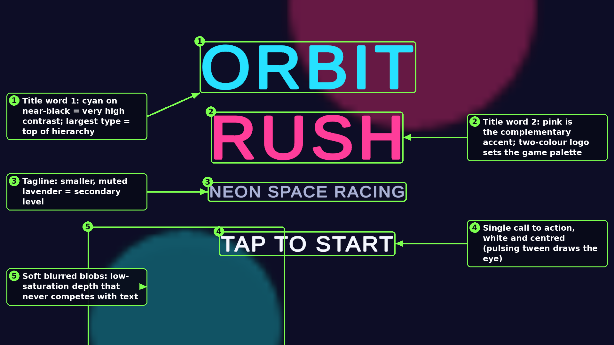 | 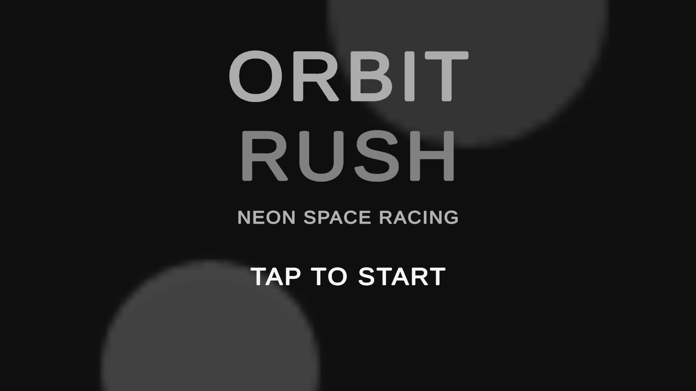 |

- **Purpose:** First impression and single clear entry point.
- **Principles / techniques:** Strong hierarchy by size (logo 200 pt > call to action 74 pt > tagline 52 pt); cyan vs magenta word split gives identity; low-alpha planets add depth without competing with text; full-screen invisible tap area = very large touch target; bottom-anchored call to action in the thumb zone.
- **Tweens:** `Pulse` on "TAP TO START" – sine loop (ease in-out), scale 1 ± 0.06, speed 2 – signals that the text is interactive. Screen exit uses the global transition.
- **Greyscale check:** No change needed – the logo words differ in value (cyan ≈ 173 vs magenta ≈ 129) and both are far brighter than the background; the tagline and TAP TO START stay readable.

## 02 – Main Menu

| Annotated colour | Greyscale |
|---|---|
| 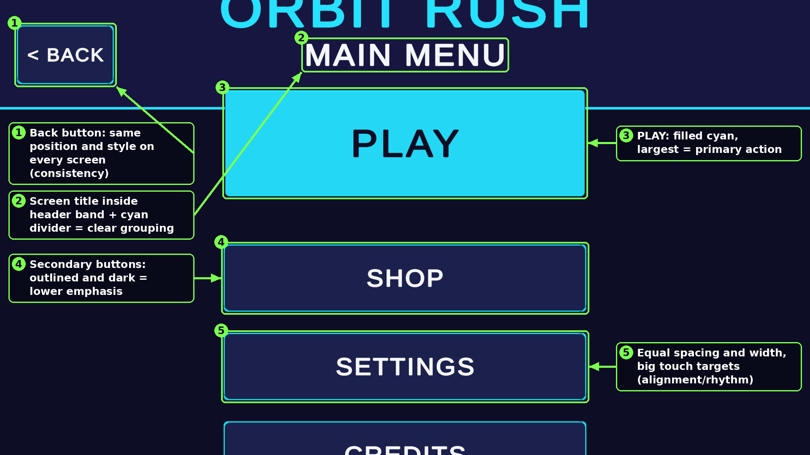 | 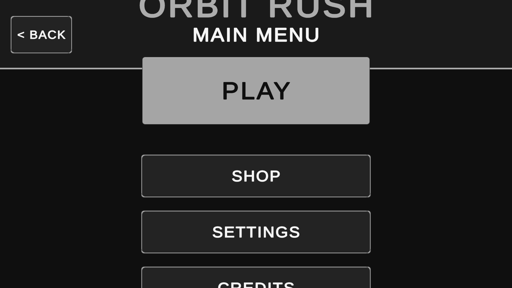 |

- **Purpose:** Hub that leads to Play, Shop, Settings and Credits.
- **Principles / techniques:** One dominant filled PLAY button (860x260, 96 pt) vs three smaller outlined secondary buttons (860x160) – clear primary/secondary hierarchy; consistent button widths and even spacing (grouping + alignment); outline on secondary buttons keeps them visible in greyscale; consistent `< BACK` in the header.
- **Tweens:** Button press/release (EaseOutQuad / EaseOutBack); global slide transition.
- **Greyscale check:** No change needed – the filled PLAY button is clearly lighter than the outlined secondary buttons, and the outlines keep them visible without hue.

## 03 – Mode Select

| Annotated colour | Greyscale |
|---|---|
| 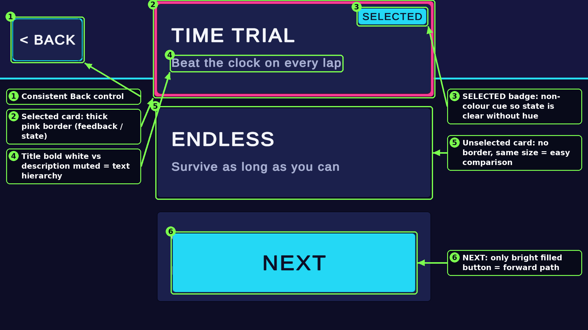 | 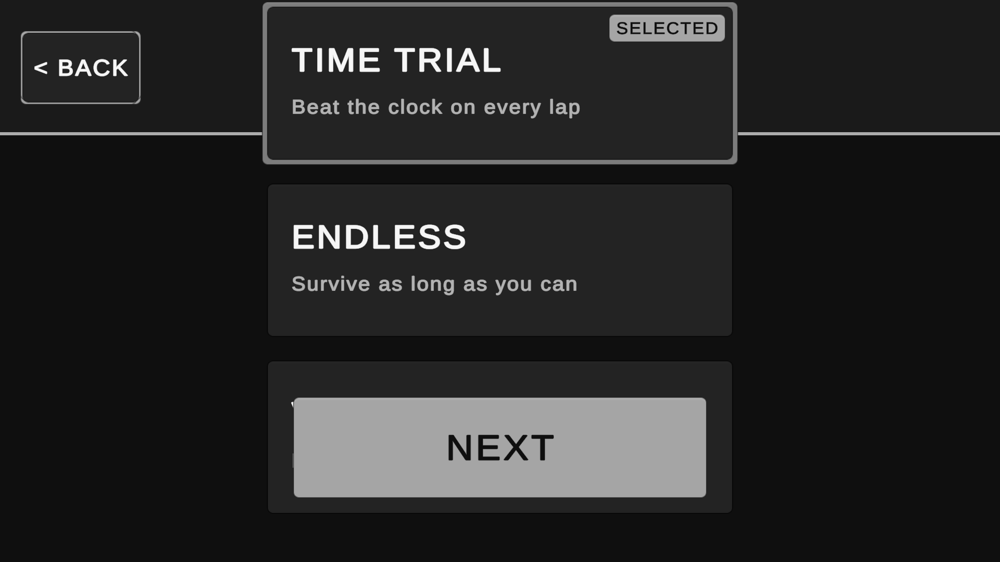 |

- **Purpose:** Choose Time Trial, Endless or Versus before continuing.
- **Principles / techniques:** Three equal cards (900x300) in a `ToggleGroup` – exactly one always selected (no invalid state); selected card shows a magenta frame **and** a "SELECTED" tag (non-colour cue); title 66 pt vs description 40 pt in subtext colour; NEXT anchored at the bottom.
- **Tweens:** `ToggleMarker` – the SELECTED tag pops in with **EaseOutBack** (0.6 -> 1.0 scale, 0.25 s) so the change of state is noticed; card press feedback.
- **Greyscale check:** No change needed – the selected card is separated by its border and the SELECTED tag (text), not only by pink vs navy.

## 04 – Level Select

| Annotated colour | Greyscale |
|---|---|
| 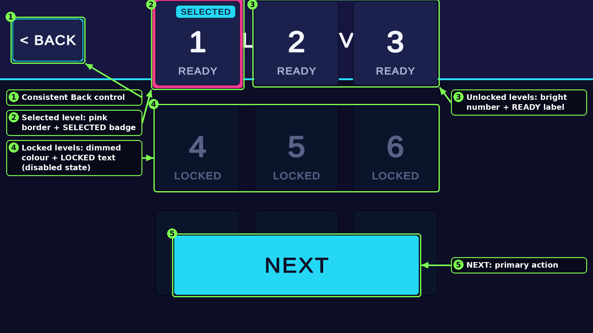 | 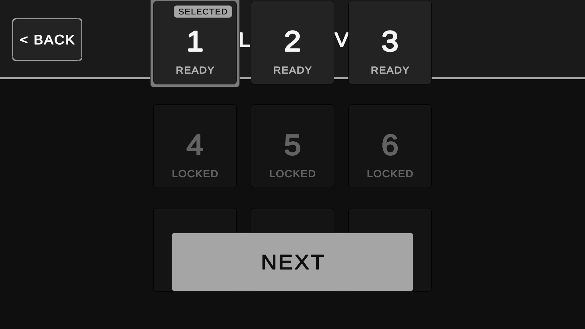 |

- **Purpose:** Pick a level from a 3x3 grid.
- **Principles / techniques:** 280x280 square cards on an even grid (alignment, repetition); levels 1–3 READY, 4–9 LOCKED with dimmed body, grey number and a text label (disabled state not communicated by colour alone); selected state identical to Mode screen (consistency).
- **Tweens:** SELECTED tag pop (EaseOutBack); press feedback only on unlocked cards (locked cards give no false affordance).
- **Greyscale check:** No change needed – LOCKED tiles are much darker with grey text, READY tiles are bright, and the selected tile has a border and tag.

## 05 – Loadout

| Annotated colour | Greyscale |
|---|---|
| 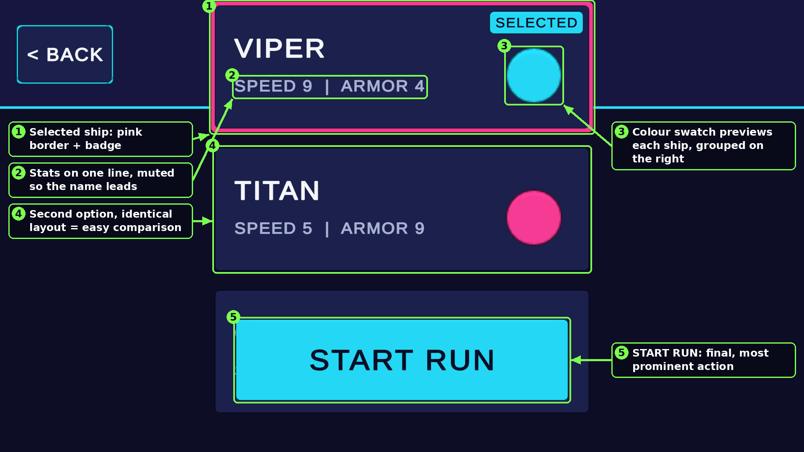 | 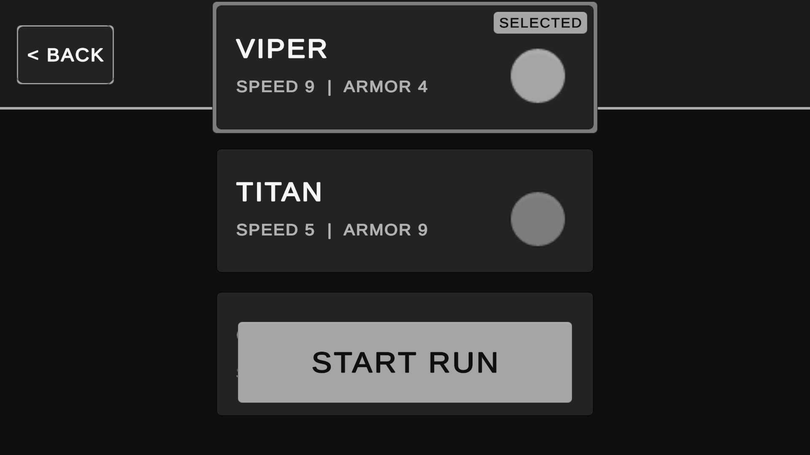 |

- **Purpose:** Choose a ship (Viper / Titan / Comet) and compare speed vs armour.
- **Principles / techniques:** Same card pattern as Mode (consistency); ship icons are colour-coded cyan / magenta / gold and also differ in value, with stats as text; right-aligned icons balance left-aligned text; START RUN is the single primary action.
- **Tweens:** SELECTED tag EaseOutBack pop; press feedback.
- **Greyscale check:** No change needed – the selected ship has a border and SELECTED tag; the cyan and magenta icons differ in value and each ship also has its name and stats as text.

## 06 – Shop

| Annotated colour | Greyscale |
|---|---|
| 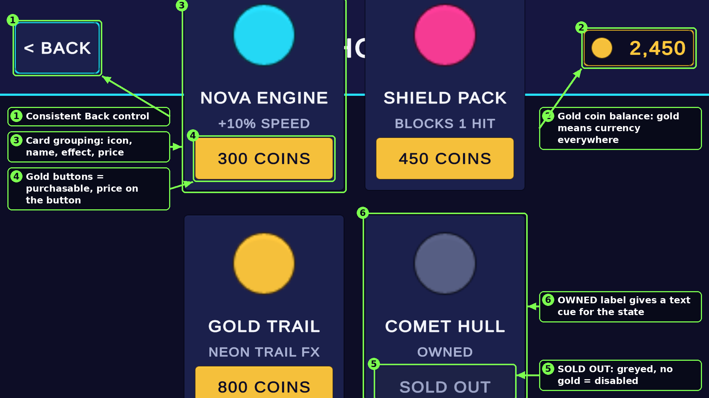 | 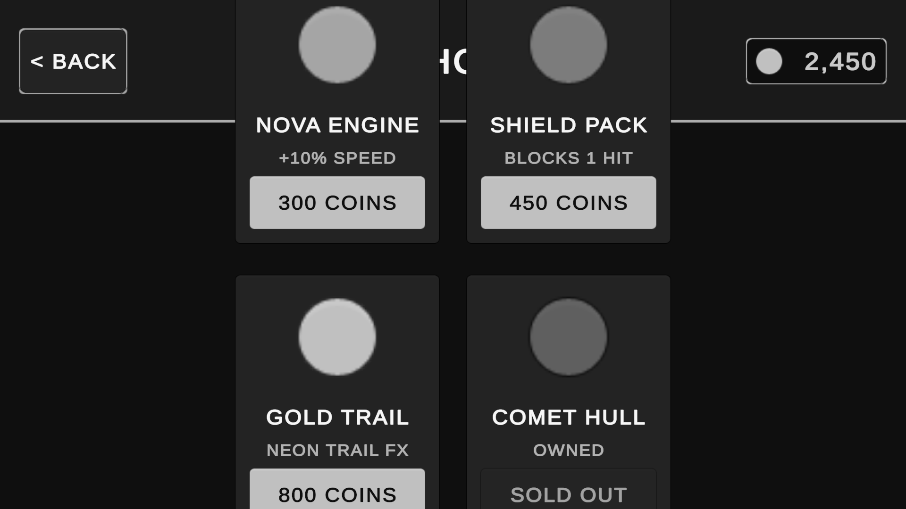 |

- **Purpose:** Spend coins on upgrades.
- **Principles / techniques:** Gold = currency everywhere (coin pill with gold outline, gold price buttons); 2x2 card grid with icon -> name -> effect -> price buttons in a fixed order; "SOLD OUT" is a disabled, low-contrast button with a text label; coin balance sits in the header where it is always visible.
- **Tweens:** Press/release feedback on price buttons; global slide transition.
- **Greyscale check:** No change needed – gold price buttons are bright, while SOLD OUT is dark with a text label; the coin pill keeps its outline.

## 07 – Settings

| Annotated colour | Greyscale |
|---|---|
| 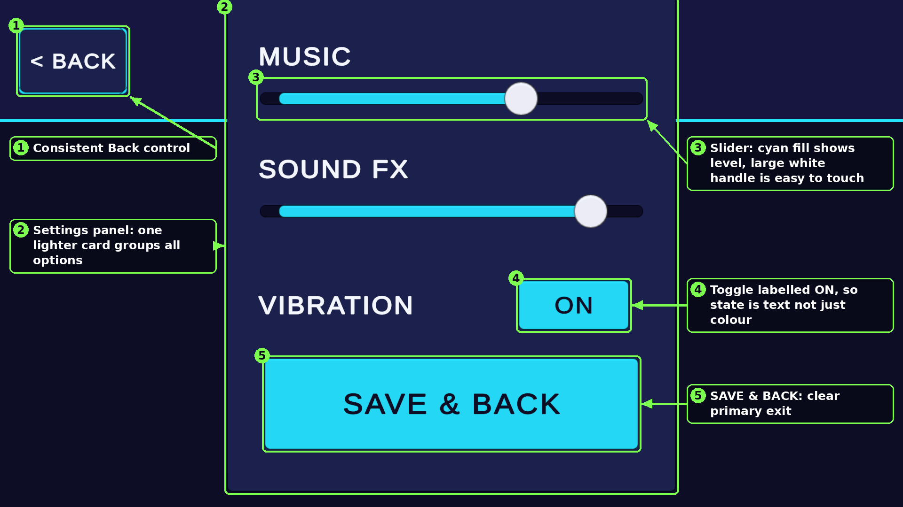 | 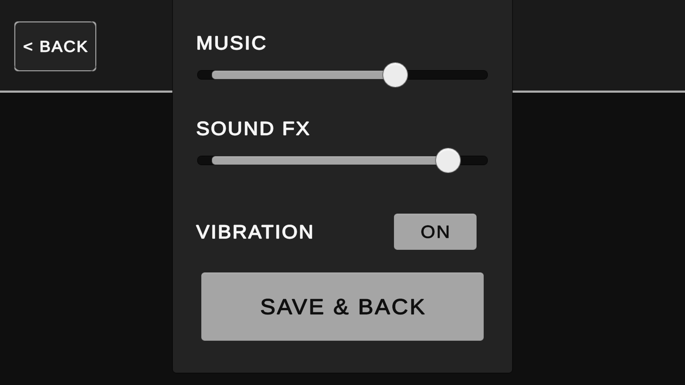 |

- **Purpose:** Adjust music, sound FX and vibration.
- **Principles / techniques:** Settings grouped on one panel card; labels left-aligned above sliders; large 80 px handles for touch; vibration toggle shows ON/OFF **text** as well as cyan/grey fill; SAVE & BACK is the only exit action.
- **Tweens:** Toggle label pops with EaseOutBack (`ToggleMarker`); press feedback; global transition.
- **Greyscale check:** No change needed – slider fill is lighter than its track, handles are near-white, and the vibration toggle says ON as text.

## 08 – Pause

| Annotated colour | Greyscale |
|---|---|
| 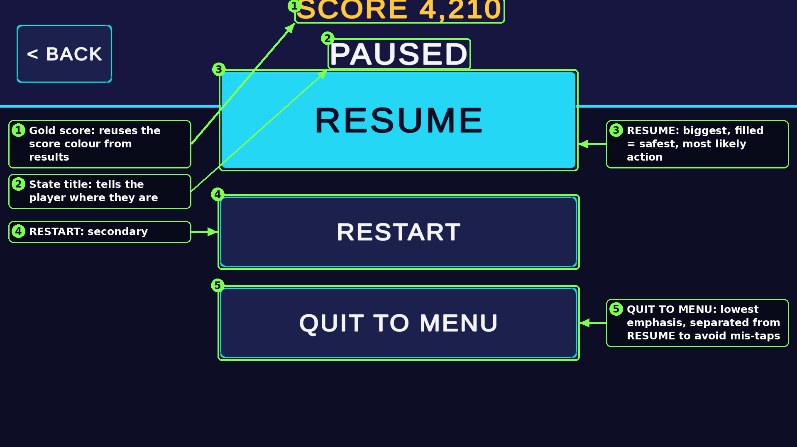 | 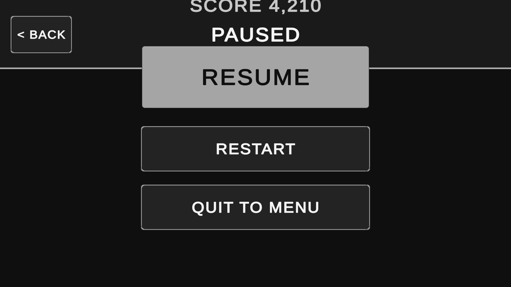 |

- **Purpose:** Freeze the run and offer Resume, Restart or Quit.
- **Principles / techniques:** RESUME is the largest, cyan, and nearest the centre (safest and most common choice); RESTART and QUIT TO MENU are outlined secondary buttons; destructive choice (quit) is last; score shown for context.
- **Tweens:** `PauseTimeScale` sets `Time.timeScale = 0` while open; every UI tween uses unscaled time so transitions and feedback still animate. Global transition.
- **Greyscale check:** No change needed – RESUME is the brightest and largest button; RESTART and QUIT TO MENU are outlined and visibly lower in value.

## 09 – Results

| Annotated colour | Greyscale |
|---|---|
| 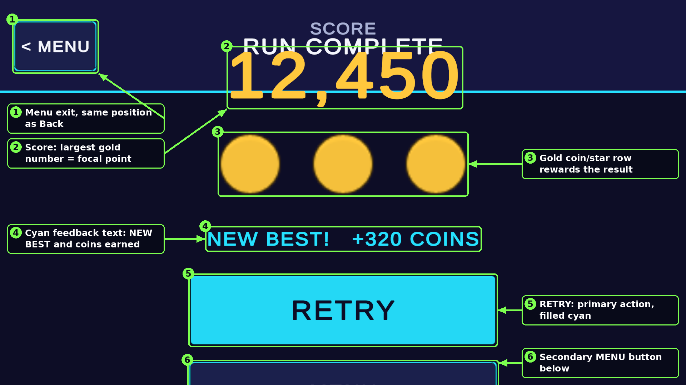 | 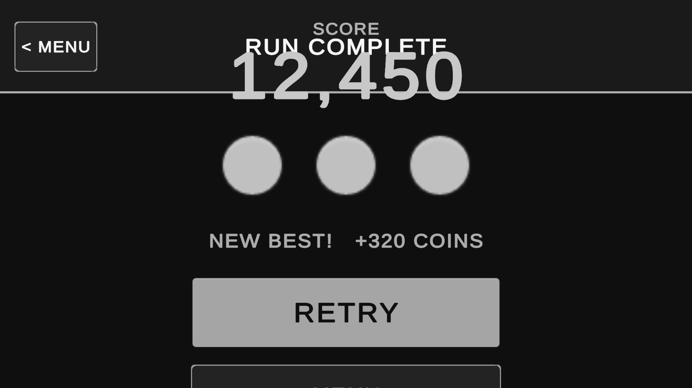 |

- **Purpose:** Reward the player and offer Retry or Menu.
- **Principles / techniques:** Score is the biggest element (190 pt gold) – clear focal point; stars and "NEW BEST!" below in descending importance; RETRY primary, MENU secondary; `< MENU` in the header gives a consistent exit.
- **Tweens:** `CountUp` – score counts 0 -> 12,450 over 1.2 s with **EaseOutCubic** (fast start, settles on the final number); `PopInSequence` – three stars pop in one by one (0.4 s initial wait, 0.15 s stagger, 0.35 s each) with **EaseOutBack** so the reward feels earned and sequential.
- **Greyscale check:** No change needed – the score is the lightest and largest element, and the gold coins stay distinct from the dark background.

## 10 – Credits

| Annotated colour | Greyscale |
|---|---|
| 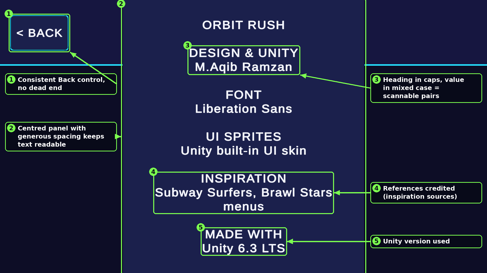 | 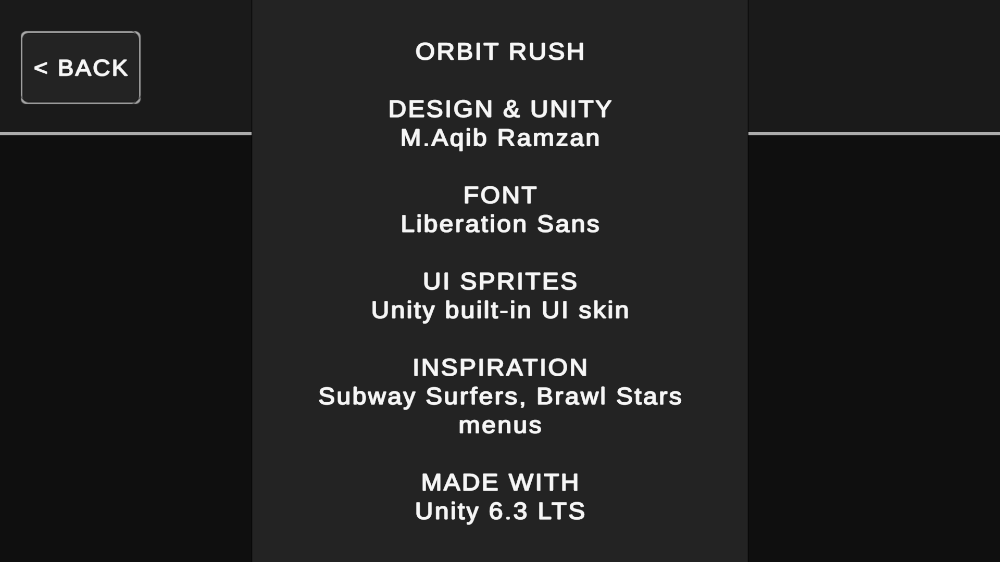 |

- **Purpose:** Attribute design, fonts, sprites and inspiration.
- **Principles / techniques:** Single readable panel card, centred text 48 pt, high-contrast light text on dark panel; consistent header and `< BACK`.
- **Tweens:** Global slide transition and button feedback only (a static reading screen should not compete with motion).
- **Greyscale check:** No change needed – light text on the dark panel keeps high contrast in greyscale.

---

## Credits and references

- Design and Unity implementation: M.Aqib Ramzan
- Font: Liberation Sans (TextMeshPro default, SIL OFL)
- UI sprites: Unity built-in UI skin (`UISprite`, `Knob`)
- Visual inspiration: Subway Surfers and Brawl Stars menus (layout and button hierarchy ideas only; no assets used)
- Easing formulas: standard Penner equations (EaseOutCubic, EaseInCubic, EaseOutQuad, EaseOutBack)
- Tools used: Unity 6.3 LTS, TextMeshPro. Annotation boxes and arrows were added to my own Unity screenshots with a Python (Pillow) script written with help from Claude (AI assistant), which also helped with Git instructions. No AI-generated images were used.
